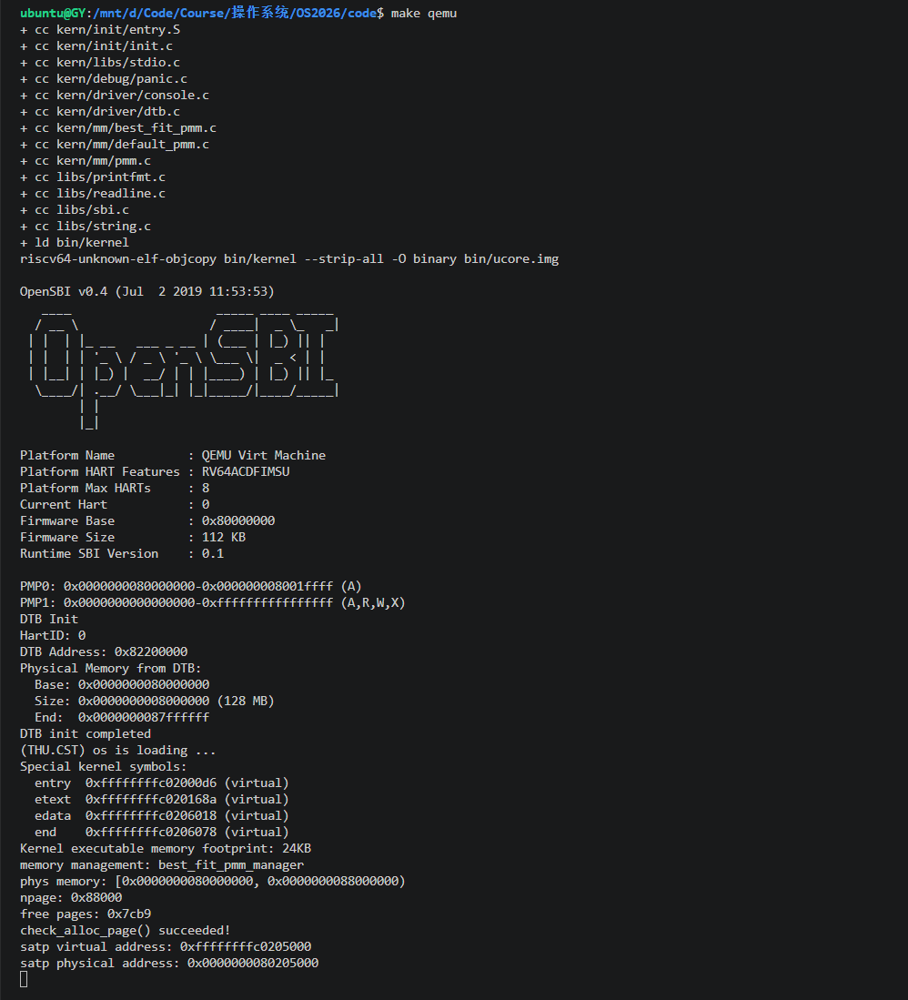
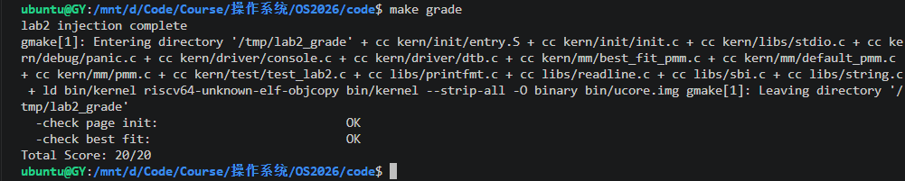

# 操作系统实验报告

## 实验基本信息

| 项目 | 内容 |
|------|------|
| **实验名称** | Lab 2: 物理内存和页表 |
| **小组成员** | 2412799-葛熠（队长）、2412133-吕鹏哲、2412679-钟一成 |
| **完成日期** | 2026-10-20 |

### 小组分工

| 成员 | 负责的练习/模块 |
|------|----------------|
| 2412799-葛熠 | 任务 1 `page_init`；任务 2 Best-Fit；环境与构建（QEMU 4.1.1 编译与适配）；报告统稿 |
| 2412133-吕鹏哲 | 任务 3 Buddy System（实现 + 测试 + 两份 prompt）；Challenge 思考题 |
| 2412679-钟一成 | 任务 4 SLUB（实现 + 测试 + 两份 prompt）；First-Fit 分析思考题 |

**报告分工**：各人先提交自己负责模块的实现说明、提示词与测试证据，由葛熠按模板统稿并交叉复核技术描述。

---

## 一、实验目的

1. 理解**页表的建立与使用**：lab2 的 `entry.S` 在内核入口用 Sv39 建立虚实映射，内核从此运行在虚拟地址空间
2. 理解**物理内存的管理方法**：从设备树发现物理内存范围，建立 `struct Page` 描述符数组，排除不可用区域后交给物理内存管理器
3. 理解**页面分配算法**：读懂 First-Fit，实现 Best-Fit，并进一步用 Buddy System 与 SLUB 理解页级分配与任意大小对象分配
4. 学习用 AI 辅助完成系统软件模块：写四段式提示词、定位 AI 生成代码中的缺陷、用可验证的测试约束实现

---

## 二、实验环境

| 成员 | AI 编程工具 | 底层模型 | 备注 |
|------|------------|---------|------|
| 2412799-葛熠 | VS Code + Copilot（Agent 模式） | DeepSeek V4.1 Flash | 改代码、跑 WSL 命令、提交推送 |
| 2412133-吕鹏哲 | VS Code + DeepSeek | DeepSeek V4 Pro | |
| 2412679-钟一成 | Codex（ChatGPT，Agent 模式） | GPT-5 | 辅助代码阅读、命令执行和实验分析 |

**运行环境**

| 项 | 值 |
|---|---|
| 宿主 | Windows 11 + WSL2 `Ubuntu2204` |
| 交叉工具链 | `riscv64-unknown-elf-gcc/ld/objcopy/objdump/nm/gdb`（`/opt/riscv-elf-toolchains/bin`） |
| 模拟器 | **QEMU 4.1.1（本地源码编译，`--enable-debug`）** + OpenSBI v0.4 |
| 构建 | `make`；评分 `make grade` |

> 为什么不用系统自带的 QEMU 7.0：lab2 的 `entry.S` 在**物理地址**上执行 `csrw satp` 打开 Sv39，
> 而页表只映射了高地址 `0xFFFFFFFFC0000000` 以上，物理 PC 在新页表中没有映射。
> QEMU 4.1.1 会让已翻译的基本块继续执行完这几条指令；QEMU 7.0 在写 satp 后立即重新翻译，
> 下一条取指即触发 instruction page fault 并被固件复位。实测证据：`si` 到
> `pc=0x80200038, satp=0x8000000000080205` 后 `pc` 立刻回到 `0x80200000`。
> 因此本实验基线采用与指导书同代的 QEMU 4.1.1。

---

## 三、实验整体逻辑分析

### 3.1 本章节的逻辑主线

lab1 结束时内核只是"能启动、能打印"，它跑在虚拟地址上却从未真正使用内存。lab2 要解决的是：
**在这套虚实映射之上，把物理内存变成可分配、可回收的资源**。

主线可以概括为一句话：**先把物理内存"看清楚"，再"登记好"，最后"发得出去、收得回来"。**

```
entry.S 建 Sv39 映射（内核进入虚拟地址空间）
   ↓
pmm_init()            物理内存管理总入口
   ├─ init_pmm_manager()   选一个分配算法，初始化其内部结构
   ├─ page_init()          ★ 发现内存、建 Page 描述符、把空闲页交给分配器
   └─ check_alloc_page()   自检：分配/释放是否正确
   ↓
alloc_pages() / free_pages()   上层此后只管调这两个接口
```

`page_init()` 是全章的枢纽：它同时涉及**设备树**（内存范围从哪来）、**地址转换**（虚实偏移）、
**描述符布局**（`struct Page` 数组放哪）、**资源排除**（固件、内核、描述符自身不能用），
后面的 Best-Fit / Buddy / SLUB 都只是在"已经登记好的空闲页集合"上换一种分配策略。

### 3.2 功能的逐步实现

1. **先确定地址口径**（`va_pa_offset`）
   内核在虚拟地址空间运行，而设备树、`end`、`struct Page *` 分属不同口径，必须先钉死 `va_pa_offset = PHYSICAL_MEMORY_OFFSET`，
   之后才有 `PADDR`/`KADDR` 的统一换算。*为什么先做*：后面每一步都依赖它，弄错则整体偏移。

2. **发现物理内存**（`get_memory_base()` / `get_memory_size()`）
   由 `dtb_init()` 从设备树读取，`page_init()` 只做校验与上界截断。*为什么第二步*：范围决定了 `npage` 与描述符数组大小。

3. **建立描述符数组**（`pages`）
   从 `ROUNDUP(end, PGSIZE)` 开始，连续放置 `(npage - nbase)` 个 `struct Page`，并全部先标记 `PG_reserved`。
   *为什么第三步*：必须先有"页面登记簿"，才能谈哪页空闲。

4. **排除已占用区域**
   OpenSBI（`0x80000000`–`0x80200000`）、内核镜像、描述符数组自身都不能进空闲区；
   实现上采用"先全标 Reserved、再从描述符数组末尾开始解封"的写法，天然排除了前两者。

5. **把空闲页交给分配器**（`init_memmap()`）
   传入的页必须已 `PageReserved`（`default_init_memmap` 里有 `assert`），且不足一页时不调用。
   *为什么最后*：这是"登记簿"交给"分配策略"的交接点，也是 `check_alloc_page()` 的前提。

6. **换一种分配策略**（Best-Fit）
   框架把分配算法抽象成 `struct pmm_manager` 的 6 个函数指针，所以 Best-Fit 只需实现同一组接口并注册，
   再让 `init_pmm_manager()` 指向它——**不改上层任何调用代码**。

7. **向两个方向延伸**：Buddy System（页级、2 的幂次块、伙伴合并）与 SLUB（在页级之上做任意大小对象分配）。

一句话概括顺序：**定地址口径 → 找内存 → 建登记簿 → 排除占用 → 交给分配器 → 换策略 → 向上下两层扩展。**

---

## 四、实验内容与实现

### 功能模块一：物理内存初始化（`page_init`）

**负责人：** 2412799-葛熠

#### 模块功能描述

**需要实现/修改的函数：**

```c
static void page_init(void);                       // kern/mm/pmm.c
static void init_pmm_manager(void);                // kern/mm/pmm.c（切换分配器）
```

**功能说明：**

`page_init()` 由 `pmm_init()` 调用，无参数无返回值。它根据设备树提供的物理内存范围，
建立可管理物理页的描述符布局，并把排除 OpenSBI、内核镜像和描述符数组占用空间后的**完整空闲页面**
交给当前 `pmm_manager`，为后续 `alloc_pages()`/`free_pages()` 提供正确的初始状态。

成功返回时应满足：`va_pa_offset` 为虚实偏移、`npage` 为页号上界、`pages` 指向页对齐的描述符数组，
且空闲区已注册；设备树信息无效时 `panic()`；没有完整空闲页时不调用 `init_memmap()`。

#### 最终提示词

````markdown
[PROMPT]
**任务**：修改 kern/mm/pmm.c，实现 page_init()，完成物理内存探测与页描述符初始化；
并把 init_pmm_manager() 的分配器切换为 best_fit_pmm_manager。
**操作要求**：必须在项目中修改实际文件；保留文件内既有代码与注释，
在 `//lab2 function1 <学号>` 标记处补全，并把 `YOUR CODE` 替换为学号。
**输出要求**：直接改文件，给出关键代码与验证方式。

[RELY]
// 宏与常量（kern/mm/memlayout.h、mmu.h）
#define PHYSICAL_MEMORY_OFFSET   0xFFFFFFFF40000000   // 虚实偏移
#define PHYSICAL_MEMORY_END      0x88000000           // 可管理物理内存上界
#define PGSIZE                   4096
#define PPN(la)                  (((uintptr_t)(la)) >> PGSHIFT)
#define ROUNDUP(a, n)            ...
// 全局变量（kern/mm/pmm.c）
struct Page *pages;  size_t npage;  uint64_t va_pa_offset;
const size_t nbase = DRAM_BASE / PGSIZE;              // 0x80000
// 可用函数
get_memory_base(), get_memory_size()   // kern/driver/dtb.c，dtb_init() 已调用
init_memmap(struct Page *base, size_t n), pa2page(uintptr_t pa), panic(), cprintf()
extern char end[];                     // 链接符号，虚拟地址
// 页面标志
SetPageReserved(page) / PageReserved(page) / SetPageProperty(page)

[GUARANTEE]
必须实现的接口：
```c
static void page_init(void);
```
其中必须完成：设置 va_pa_offset；由 DTB 得到 [mem_base, mem_end)；
计算 npage；在 end 之后页对齐处放置 pages 数组；把内核与描述符数组占用的页标记为 Reserved；
对剩余完整空闲页调用 init_memmap()。允许新增局部变量与 static 辅助函数。

[SPECIFICATION]
## page_init
**Pre-Condition**：pmm_init() 已调用 init_pmm_manager()，pmm_manager 非空；dtb_init() 已执行。
**Post-Condition**：va_pa_offset == PHYSICAL_MEMORY_OFFSET；npage == PPN(mem_base + mem_size) 且 > nbase；
pages 非空、页对齐、位于 ROUNDUP(end, PGSIZE) 之后；空闲页总数在 (0, npage - nbase] 内；
内核尾部页与描述符数组所在页均为 PageReserved。
**Case 1（DTB 无效）**：mem_base 或 mem_size 为 0 → panic() 终止，不继续初始化。
**Case 2（内存上界超出可管理范围）**：mem_end > PHYSICAL_MEMORY_END → 截断到 PHYSICAL_MEMORY_END。
**Case 3（无非空完整页）**：描述符数组末尾对齐后已 ≥ mem_end → 打印提示并直接返回，**不得调用 init_memmap()**。
**Case 4（正常）**：从描述符数组之后到 mem_end 的完整页全部注册为空闲区。
**Requirements**：不得把 OpenSBI（0x80000000–0x80200000）、内核镜像、描述符数组任一页放入空闲区；
区分虚拟地址、物理地址与页号；可重复构建运行（make clean && make qemu）。
````

#### 实现迭代过程

本模块的实现经历了 2 次迭代。

##### 第一次迭代：先按"直觉版"写出

**提示词**：按上面的四段式规格生成 `page_init()`，只需先保证"能从 DTB 拿到范围、建好 pages 数组、把空闲页注册出去"。

**结果**：生成版本能得到内存范围与 `pages` 指针，但存在三处与测试要求不符：

- `npage` 用了 `PPN(mem_size)`，把**大小**当成了**地址**；
- `pages` 直接放在 `end` 上，未做 `ROUNDUP(..., PGSIZE)`，导致 `[Test 1] FAIL (pages not page-aligned)`；
- 空闲区从 `mem_base` 开始注册，把 OpenSBI 与内核镜像一起吃进了空闲链表。

**问题解决策略**：在提示词的 [SPECIFICATION] 里把测试的检查项逐条写成 Post-Condition/Case
（地址口径、对齐、`npage > nbase`、末尾页与描述符页必须 Reserved、无完整页不得注册），
并要求"先全标 Reserved 再解封"这一策略必须体现。

##### 第二次迭代：按规格重写并验证

**结果**：`make` 通过；`make qemu` 输出

```
phys memory: [0x0000000080000000, 0x0000000088000000)
npage: 0x88000
free pages: 0x7cb9
check_alloc_page() succeeded!
satp virtual address: 0xffffffffc0205000
satp physical address: 0x0000000080205000
```

`npage = 0x88000 = 0x88000000 >> 12`，`free pages = 0x7cb9`（排除固件与内核/描述符占用后的剩余），
`make grade` 的 `[Test 1] Page Init: PASS`。

**关键改进点：**

1. 在 [RELY] 里给出 `PHYSICAL_MEMORY_OFFSET`、`PHYSICAL_MEMORY_END`、`nbase` 的**真实数值**，
   AI 才不会把"大小"当"地址"；
2. 在 [SPECIFICATION] 中把"排除已占用页"写成可验证的后置条件（两处 `PageReserved` 检查），
   而不是一句"记得排除"；
3. 明确 `init_memmap()` 的调用条件（`free_start < mem_end`），避免 0 页注册触发断言。

---

### 功能模块二：Best-Fit 连续物理内存分配器

**负责人：** 2412799-葛熠

#### 模块功能描述

**需要实现/修改的接口：**

```c
static void best_fit_init(void);
static void best_fit_init_memmap(struct Page *base, size_t n);
static struct Page *best_fit_alloc_pages(size_t n);
static void best_fit_free_pages(struct Page *base, size_t n);
static size_t best_fit_nr_free_pages(void);
const struct pmm_manager best_fit_pmm_manager;   // 注册
```

**功能说明：**

`kern/mm/best_fit_pmm.c` 的骨架只提供 `basic_check()` 与 `best_fit_check()` 两个测试函数，
不提供管理函数声明与 `pmm_manager` 结构，因此内部状态、6 个接口函数与注册结构都要自行设计。
Best-Fit 在分配时**遍历空闲链表挑选"能装下 n 页且剩余最小"的块**，
块大于需求时切出尾部作为新的空闲块；回收时按地址插入并与前后相邻空闲块合并。

测试函数直接引用 `free_list` 与 `nr_free`，因此内部状态的命名必须与 First-Fit 保持一致。

#### 最终提示词

````markdown
[PROMPT]
**任务**：在 kern/mm/best_fit_pmm.c 中实现完整的 Best-Fit 物理内存管理模块，并注册
best_fit_pmm_manager；在 kern/mm/pmm.c 的 init_pmm_manager() 中切换为它。
**操作要求**：只能修改 `//lab2 function2-2 <学号>` 标记处以及文件末尾（用于追加注册结构）；
**不得修改 basic_check() 与 best_fit_check()**。
**输出要求**：直接改文件；说明分配与合并策略；给出验证命令。

[RELY]
// 测试函数（只读，必须满足其状态约定）
list_entry_t free_list_store = free_list;      // 直接引用 free_list
unsigned int nr_free_store = nr_free;          // 直接引用 nr_free
assert(PageProperty(p));                        // 空闲块首必须置 PG_property
assert(!PageProperty(p0));                      // 已分配块首必须清 PG_property
// 框架（kern/mm/pmm.h, libs/list.h, memlayout.h）
struct pmm_manager { name, init, init_memmap, alloc_pages, free_pages, nr_free_pages, check };
free_area_t { list_entry_t free_list; unsigned int nr_free; };
list_init/list_add/list_add_before/list_del/list_next/list_prev/list_empty/le2page
SetPageProperty/ClearPageProperty/PageProperty/PageReserved/set_page_ref
// 参考实现（只读）：kern/mm/default_pmm.c 的 First-Fit

[GUARANTEE]
必须实现（签名与 struct pmm_manager 成员一致）：
```c
static void best_fit_init(void);
static void best_fit_init_memmap(struct Page *base, size_t n);
static struct Page *best_fit_alloc_pages(size_t n);
static void best_fit_free_pages(struct Page *base, size_t n);
static size_t best_fit_nr_free_pages(void);
const struct pmm_manager best_fit_pmm_manager;
```
允许新增 static 辅助函数（如链表插入、合并）；内部状态建议
`static free_area_t free_area;` + `#define free_list (free_area.free_list)` + `#define nr_free (free_area.nr_free)`。

[SPECIFICATION]
## best_fit_alloc_pages(n)
**Pre-Condition**：n > 0。
**Post-Condition**：返回满足 `property >= n` 的**最小**空闲块首地址；该块从链表摘除；
若原块大于 n，则把 `base + n` 起的剩余部分作为新空闲块（`property = 原值 - n`、`SetPageProperty`）保留；
`nr_free` 减去 n；返回块 `ClearPageProperty`。
**Case 1（n > nr_free）**：返回 NULL，链表不变。
**Case 2（无满足块）**：返回 NULL，链表不变。
**Case 3（恰好相等）**：整块摘除，不产生剩余块。
**Requirements**：不得返回 `PageReserved` 的页；返回块的 `ref` 置 0。

## best_fit_free_pages(base, n)
**Pre-Condition**：`base` 是此前由 `alloc_pages` 返回的块首；这些页 `!PageReserved && !PageProperty`。
**Post-Condition**：这 n 页成为一个空闲块（`base->property = n`、`SetPageProperty`），按地址升序插入链表；
与前一块相邻（`prev + prev->property == base`）则合并到前块；再与后一块相邻（`base + property == next`）则合并；
`nr_free` 增加 n。
**Requirements**：合并后只保留一个头页带 `PG_property`，被吞并块的首页必须 `ClearPageProperty`。

## best_fit_init_memmap(base, n)
**Pre-Condition**：这 n 页均为 `PageReserved`（由 page_init 标记）。
**Post-Condition**：逐页清 flags/property/ref 后，`base` 成为长度为 n 的空闲块，按地址升序插入链表，`nr_free += n`。
````

#### 实现迭代过程

本模块的实现经历了 3 次迭代。

##### 第一次迭代：照抄 First-Fit 只改"选块条件"

**提示词**：以 `default_pmm.c` 为模板，把 First-Fit 的"第一个满足 `property >= n` 的块"改成"最小的满足块"。

**遇到的问题：**

- **编译失败**：测试函数用的是 `free_list` / `nr_free` 两个标识符，
  生成版本把它们写成 `free_area.free_list`，导致
  `error: 'free_list' undeclared`、`error: 'nr_free' undeclared`（4 处）。
- 原因分析：测试函数是骨架的一部分、不得修改，内部状态必须以宏别名形式暴露同名标识符。

**问题解决策略**：在 [RELY] 里把测试函数引用的两个标识符原样列出，并给出 `#define` 别名的写法；
在 [GUARANTEE] 中写明"内部状态命名必须与测试一致"。

##### 第二次迭代：能编译，但 `make qemu` 断言失败

**遇到的问题：**

```
kernel panic at kern/mm/best_fit_pmm.c:...:
    assertion failed: !PageProperty(p0)
```

原因：分配时只把块首从链表摘下，却未 `ClearPageProperty`，测试用"块首是否仍有 `PG_property`"
判断"是否已分配"。另外切尾时把剩余部分插到了链表头，破坏了按地址升序的不变式，
后续合并逻辑读到了错误的前驱。

**问题解决策略**：在 [SPECIFICATION] 的 Post-Condition 中显式写出
"返回块必须 `ClearPageProperty`""剩余块插在原位置之后（`list_add(prev, &rest)`）""链表保持地址升序"，
并要求"合并只保留一个 `PG_property` 头"。

##### 第三次迭代：切换分配器并取得满分

**遇到的问题：**

```
-check best fit: WRONG
error: missing "[Test 2] Best-Fit: PASS"
```

原因：只实现了模块但没有切换，`init_pmm_manager()` 仍指向 `default_pmm_manager`，
`test_best_fit()` 检查 `pmm_manager == &best_fit_pmm_manager` 失败。

**问题解决策略**：把"切换 `init_pmm_manager()`"写进 [PROMPT] 的任务描述（而不是留给 AI 自己判断），
避免"实现了但没接上"。

**最终结果：**

```
$ make grade
lab2 injection complete
  -check page init:                          OK
  -check best fit:                           OK
Total Score: 20/20
```

**关键改进点总结：**

1. [RELY] 里补充测试函数实际引用的标识符与状态约定（`free_list`/`nr_free`、`PageProperty` 语义），
   把"框架隐含契约"显式化；
2. [SPECIFICATION] 用 Pre/Post-Condition 描述**链表不变式**（地址升序、只有一个头页带 `PG_property`），
   比描述"怎么合并"更容易被验证；
3. 把"注册 + 切换"写进任务，而不是只描述算法本身。

---

### 功能模块三：Buddy System 分配器

**负责人：** 2412133-吕鹏哲

<!-- 待吕鹏哲填写：模块功能描述 / 最终提示词（两份）/ 实现迭代过程 / 测试覆盖说明 -->

---

### 功能模块四：SLUB 分配器

**负责人：** 2412679-钟一成

<!-- 待钟一成填写：模块功能描述 / 最终提示词（两份）/ 实现迭代过程 / 测试覆盖说明 -->

---

### 思考题一：First-Fit 分配器如何工作，有什么改进空间

**负责人：** 2412679-钟一成

<!-- 待钟一成填写 -->

---

### 思考题二：Challenge —— OS 如何获取可用物理内存范围

**负责人：** 2412133-吕鹏哲

<!-- 待吕鹏哲填写 -->

---

### 思考题三：Best-Fit 是否有进一步改进空间

**负责人：** 2412799-葛熠

有，主要有四个方向：

1. **查找代价**：每次分配都要遍历整个空闲链表，时间复杂度 O(n)。可把空闲块按大小组织成分级的
   分离空闲链表（segregated free list），或维护大小索引，把"找最小满足块"降到近似 O(1)。
2. **外部碎片**：Best-Fit 倾向于留下大量极小残块，这些块往往小于任何请求而永久闲置。
   可设最小块阈值（小于阈值不再切分，整块给出），或定期规整。
3. **只按大小选块，不看地址**：可能把彼此相邻的块分给不同请求，导致本可合并的区间被拆散；
   可在同等大小的候选中优先选与已有空闲块相邻的块。
4. **无法响应"对齐/连续大块"需求**：若上层需要 2 的幂次或物理连续大块，Best-Fit 会反复切分。
   这正是 Buddy System 的动机——按 2 的幂次维护，伙伴合并判断是 O(1)。

---

## 五、测试与验证

### 5.1 运行结果（`make qemu`）

```
OpenSBI v0.4 (Jul  2 2019 11:53:53)
...
DTB Address: 0x82200000
Physical Memory from DTB:
DTB init completed
(THU.CST) os is loading ...
Special kernel symbols:
  entry  0xFFFFFFFFC02000d6 (virtual)
  end    0xFFFFFFFFC0206078 (virtual)
Kernel executable memory footprint: 24KB
memory management: best_fit_pmm_manager
phys memory: [0x0000000080000000, 0x0000000088000000)
npage: 0x88000
free pages: 0x7cb9
check_alloc_page() succeeded!
satp virtual address: 0xffffffffc0205000
satp physical address: 0x0000000080205000
```



| 输出 | 含义 |
|---|---|
| `Physical Memory from DTB` | 物理内存范围来自设备树，而非硬编码 |
| `memory management: best_fit_pmm_manager` | 分配器已切换为 Best-Fit |
| `npage: 0x88000` | `0x88000000 >> 12`，页号上界 |
| `free pages: 0x7cb9` | 排除固件/内核/描述符后的可用页数 |
| `check_alloc_page() succeeded!` | `pmm_manager->check()` 通过（含 6 个细项） |
| `satp physical address: 0x80205000` | 引导页表物理地址，说明虚实映射已生效 |

### 5.2 自动评分（`make grade`）

```
  -check page init:                          OK
  -check best fit:                           OK
Total Score: 20/20
```



`make grade` 会把代码复制到 `/tmp/lab2_grade`，用 `tools/inject.py` 注入 `tools/test_lab2.c`
（在 `pmm_init()` 末尾追加 `test_page_init(); test_best_fit();`），再由 `tools/grade.sh` 启动 QEMU
逐行匹配 `[Test 1] Page Init: PASS` 与 `[Test 2] Best-Fit: PASS`。

`test_page_init()` 共 8 项检查，可视为 `page_init()` 的验收清单：
`va_pa_offset`、DTB 范围有效、`npage` 与 `nbase` 关系、`pages` 非空/页对齐/位于 `end` 之后、
空闲页数量范围、内核尾部页 Reserved、描述符数组页 Reserved、`pa2page(page2pa(q)) == q`。

### 5.3 扩展模块验证

<!-- 待吕鹏哲（Buddy）、钟一成（SLUB）补充各自的测试输出与截图 -->

---

## 六、实验总结与收获

### 6.1 本实验知识点与 OS 原理的对应

| 本实验的知识点 | OS 原理中的对应知识点 | 含义、关系与差异 |
|---|---|---|
| `va_pa_offset` + Sv39 页表：内核在 `0xFFFFFFFFC0200000` 运行，物理在 `0x80200000` | 地址转换 / 虚拟内存 | 同一机制的两面：实验里是"一段固定偏移的直映射"，原理课上是多级页表 + 按需映射。差异在于本实验只有内核态、单一映射，尚无进程独立地址空间与按需分页 |
| `struct Page` 数组 + `pages`/`npage` | 物理页帧管理（页框数据库） | 完全对应：每个物理页一个描述符，记录引用计数与状态。差异是本实验描述符数组在 `end` 之后**静态预留**，内核里通常由引导期分配器动态管理 |
| `free_area_t` + 双向链表 + `property` | 连续内存分配（空闲链表/分区） | 对应"空闲区描述"的经典做法。差异是本实验只维护一条全局空闲链表，Linux 用 buddy + 分离链表 + per-CPU 缓存 |
| Best-Fit / First-Fit 的选择与切分 | 动态分区分配的放置策略与外部碎片 | 概念一一对应。差异是教材按"字节"讨论碎片，实验以 4KB 页为单位 |
| Buddy System：2 的幂次块 + 伙伴合并 | 伙伴系统（页级分配器） | 同一算法。差异是实验面向页、只做单阶链表的最简实现，未实现"按阶位分链表 + 位图" |
| SLUB：页级之上做对象级缓存 | slab/slub 分配器、内核对象缓存 | 对应"两级分配"思想。差异是简化实现，未涉及 per-CPU 缓存、构造/析构与碎片整理 |
| `pmm_manager` 函数指针表 | 分配器抽象、策略与机制分离 | 对应内核里分配器 ops 的分层。差异是实验编译期选定单一管理器 |
| `make grade` 的注入式测试 | 单元测试 / 断言自检 | 对应内核 `BUG_ON`/`panic` 与自检。差异是实验用外部脚本注入测试函数 |

### 6.2 OS 原理中重要但本实验未覆盖的知识点

1. **按需分页与缺页异常处理**：页表是启动时一次性建好的固定映射，没有 page fault 处理路径。
2. **进程地址空间与写时复制**：只有一个内核地址空间，`satp` 只在启动时写一次。
3. **页替换算法**：没有换页设备，也没有 LRU/Clock 等替换策略。
4. **内存回收与对象生命周期**：SLUB 只做到分配/释放，没有 shrinker 与引用计数回收。
5. **NUMA 与内存热插拔**：物理内存被当作单一平坦区间处理。
6. **虚拟内存区域管理（VMA）**：没有 `mmap`/`brk` 语义，也没有按区的权限位设置。
7. **并发与锁**：所有分配路径单线程、无中断，未考虑自旋锁 / per-CPU 缓存带来的竞态。

### 6.3 AI 协作开发的经验

1. **把"框架隐含契约"写进 [RELY] 是关键。** `best_fit_pmm.c` 的测试函数直接引用 `free_list`/`nr_free`，
   这层约定不在任何头文件里；不写清楚，AI 生成的代码编译就过不了（实测 4 处 undeclared）。
2. **用 Pre/Post-Condition 描述不变式，比描述步骤有效。** 第一次生成的 Best-Fit 逻辑"看起来对"，
   但破坏了"链表按地址升序、只有一个头页带 `PG_property`"两条不变式，断言立刻炸；
   把不变式写进 [SPECIFICATION] 后一次通过。
3. **环境差异必须先定位、再改代码。** lab2 在 QEMU 7 下"只出 OpenSBI banner"，
   一开始怀疑 `page_init` 写错；用 GDB 单步发现是 `csrw satp` 之后取指 page fault
   （物理 PC 在新页表中无映射），换用 QEMU 4.1.1 后立即正常。这类问题靠读代码找不到，必须先拿运行时证据。
4. **不要相信"export 到 .bashrc 就生效"。** `.bashrc` 开头有 `case $- in *i*) ;; *) return;; esac`，
   非交互 shell（`wsl -d X bash -c`、任务、脚本）不会执行后面的 export。
   最终把默认值写进 Makefile（`ifndef QEMU` + 探测本地路径），不再依赖环境变量。
5. **让 AI 自证**：所有结论都附 `objdump`/`nm`/GDB/评分输出；本次 `npage`、`free pages`、
   `satp physical address` 都能与常量互相对上，报告里的每个数字都可复现。

---

## 七、附录：提交记录

| 提交 | 内容 | 作者 |
|---|---|---|
| `35378c9` | lab2 分支骨架（code/ + report/） | 葛熠 |
| `8084a7d` | `page_init` + Best-Fit 实现 | 葛熠 |
| `b479f2e` | Makefile 默认优先使用本地 QEMU 4.1.1 | 葛熠 |
| `c383ca6` | 加入 `make qemu` / `make grade` 截图 | 葛熠 |
| — | 任务 3 Buddy System | 吕鹏哲 |
| — | 任务 4 SLUB | 钟一成 |
