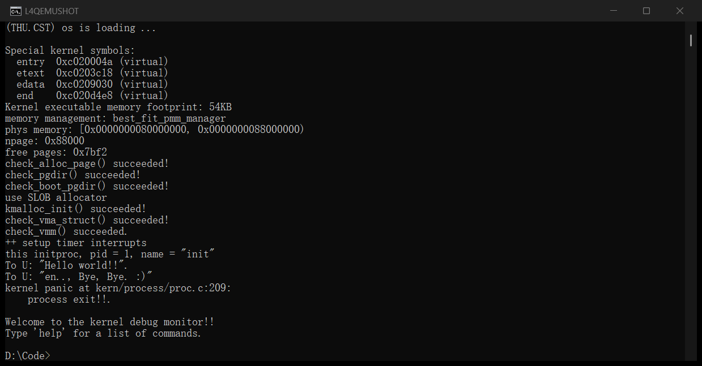
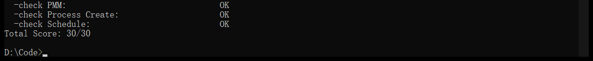

# 操作系统实验报告

## 实验基本信息

| 项目 | 内容 |
|---|---|
| 实验名称 | Lab 4：进程管理 |
| 小组成员 | 2412799-葛熠（队长）、2412133-吕鹏哲、2412679-钟一成 |
| 完成日期 | 2026-11-15 |

### 小组分工

| 成员 | 负责的模块 |
|---|---|
| 2412799-葛熠 | lab2/lab3 代码回填、环境与构建、功能模块一 `page_insert` / `page_remove`、报告统稿 |
| 2412133-吕鹏哲 | 功能模块三 `switch_to` / `schedule` / `proc_run` / `cpu_idle` |
| 2412679-钟一成 | 功能模块二 `alloc_proc` / `proc_init` / `kernel_thread` / `do_fork` / `copy_thread` / `copy_mm` |

## 一、实验目的

来自指导书，三条：

1. 了解**虚拟内存管理的基本结构**，掌握虚拟内存的组织与管理方式；
2. 了解**内核线程创建/执行**的管理过程；
3. 了解内核线程的**切换和基本调度**过程。

落到代码上，就是让内核从 lab3 的"能被打断并原样恢复"再往前走一步——从**只有一个执行流**
变成"能造出多个执行实体、登记它们、并让它们轮流占用 CPU"：

```
lab3 结束：kern_init 一条路跑到底，最后停在 cpu_idle 死循环
lab4 目标：kern_init → proc_init 造出 idleproc/initproc
                     → cpu_idle 触发调度 → schedule 选一个 → switch_to 换现场
                     → init_main 真正跑起来，打印自己的 pid 和名字
```

## 二、实验环境

| 项 | 值 |
|---|---|
| 宿主机 | Windows 11 + WSL2（Ubuntu 22.04） |
| 交叉工具链 | `riscv64-unknown-elf-gcc 15.1.0`、GDB 16.3（`/opt/riscv-elf-toolchains/bin`） |
| 模拟器 | 本地编译的 **QEMU 4.1.1**（`~/opt/qemu-4.1.1/bin/qemu-system-riscv64`），自带 OpenSBI v0.4 |
| 构建命令 | 在 `<仓库根>/code` 下 `make`、`make qemu`、`make grade` |

**为什么必须 4.1.1**：`Makefile` 的 `qemu`/`debug` 与 `tools/grade.sh` 都用
`-device loader,file=bin/ucore.img,addr=0x80200000`，靠 QEMU 的 virt 机器把 `next_addr` 传给 OpenSBI。
系统里若装了 QEMU 7.0 并排在 PATH 前面，它**不传这个值**，固件直接跳到 `0x0`，
表现是 `make grade` **不报错但 0 分**、串口日志只有 OpenSBI banner。用 `which qemu-system-riscv64`
确认版本再跑。

**四处工具链兼容修复**（材料按更老的编译器写的，不改根本编不过）：

| 报错 | 原因 | 改法 |
|---|---|---|
| `fatal error: best_fit_pmm.h: No such file or directory` | 材料里 `default_pmm.c:3` include 了这个头，却没提供文件 | 自建同名头，只声明 `default_pmm_manager` |
| `'PHYSICAL_MEMORY_END' undeclared` | lab4 的 `memlayout.h` 缺这个宏（lab3 也踩过） | 补 `#define PHYSICAL_MEMORY_END 0x88000000` |
| `kmalloc.c:92 error: passing argument 1 of 'kva2page' makes pointer from integer` | GCC 14 起 `-Wint-conversion` 默认是 error；`__slob_free_pages(unsigned long kva)` 把整数直接喂给要指针的 `kva2page` | `kva2page((void *)kva)` |
| `test_lab4.c: error: passing argument 1 of 'kernel_thread' from incompatible pointer type` | 评分测试的线程函数是 `void (*)(void *)`，而 `kernel_thread` 要 `int (*)(void *)`；GCC 14 起默认为 error | `CFLAGS` 加 `-Wno-int-conversion -Wno-incompatible-pointer-types`。**不改评分测试文件**，换任何一份 `test_lab4.c` 都能编过 |

> 组内环境不完全一致：一位成员的本机 WSL 是更新版本、且需要自备 GCC 13.2.0 工具链
> （riscv-collab 预编译的 gdb 缺 `libpython3.10`），其记录见功能模块三的"实现迭代过程"。
> 上面这张表是课程材料与新版编译器之间的差异，与具体机器无关。

## 三、实验整体逻辑分析

### 3.1 本章节的逻辑主线

指导书的执行链可以概括成一行：

```
kern_init → pmm_init → pic_init/idt_init → vmm_init → proc_init → cpu_idle
                                                                     ↓
                                                  schedule → proc_run → switch_to
```

**前半段把地址空间准备好，后半段让第一个可运行线程真正跑起来。** 换成"要解决什么问题"的顺序，是这样四步：

1. **先在页表上能挂页**（模块一）。`vmm_init()` 里的 `check_vma_struct()` 只验证 VMA 链表的插入/查找，
   但"一个线性地址究竟映射到哪一页物理内存"这件事，在 lab4 之前根本没有实现——
   `page_insert`/`page_remove` 只有声明（`pmm.h:46-47`），实现是空的。没有这两个函数，
   页表测试 `check_pgdir()`/`check_boot_pgdir()` 编译都过不了，后面更谈不上给线程准备地址空间。
2. **再造出执行实体**（模块二）。有了 PCB、内核栈、trapframe，才有"线程"这个东西存在。
   这一步的关键不是分配内存，而是回答**"新线程第一次从哪里开始跑"**——
   答案是一条预先构造好的 trapframe：`epc = kernel_thread_entry`、`s0 = fn`、`s1 = arg`。
3. **再让实体上 CPU**（模块三）。`schedule` 负责**选谁**，`proc_run` 负责**登记 + 切页表**，
   `switch_to` 负责**搬寄存器**。三者职责严格分离，任何一环错都表现为"切过去就崩"。
4. **最后用两条官方测试闭环**：`make qemu` 里看到 `this initproc, pid = 1, name = "init"` 与三行 `To U`，
   证明"造出来 → 切过去 → 跑起来"整条链是通的；`make grade` 30/30 证明三个模块各自达标。

整章的难点其实集中在一个交汇点上——**`forkret → forkrets → __trapret → kernel_thread_entry`
这条"首次运行链路"**。它跨越模块二（构造 trapframe、设 `context.ra`）与模块三（`switch_to` 的 `ret`
落到 `ra`），两边字段对不上就崩，所以是分工之后必须联调的地方。

### 3.2 功能的逐步实现

我们按"能编译 → 能启动 → 能造线程 → 能切换"四级推进，每一级都有明确的判据：

1. **回填 lab2 + lab3**（葛熠）。指导书明确写了"本实验依赖实验2/3"。不搬 `page_init` 与 Best-Fit，
   `npage`/`pages[]`/空闲链表全是空的；不搬 `interrupt_handler`/`exception_handler`/`RESTORE_ALL`，
   `trap.c` 与 `trapentry.S` 直接编译失败。这一级完成后的判据是：**`make` 通过、`make qemu` 能看到 `check_*` 全过**。
2. **写 `page_insert`/`page_remove`**（模块一）。完成后的判据是 `check_pgdir() succeeded!`——
   这个框架自带的检查会反复 `page_insert`/`page_remove` 并断言引用计数，等于免费给了我们一份验收。
   `make grade` 此时 **10/30**（`check PMM: OK`）。
3. **写模块二的六个函数**（钟一成）。判据是 `[Test Process Create] PASS`，总分 **20/30**。
   注意这条测试注入在 `proc_init()` 末尾，只断言 `current` 与两个 PCB 的字段，
   所以它**不需要** `switch_to` 真正实现。
4. **写模块三的四个函数**（吕鹏哲）。判据是 `[Test Schedule] PASS` + 运行时三行 `To U` 消息，总分 **30/30**。
5. **统稿与取证**（葛熠）。三份文档、报告两万字、`make qemu`/`make grade` 截图。

一个实际观察：**四步之间是"编译依赖"而不是"逻辑依赖"**。模块一不做，`pmm.h` 里的声明没人实现，
链接就过不了；但模块二、三之间只靠 `proc.h` 已有声明通信，可以并行。
这也是我们把三个模块一人一个分下去的前提。


## 四、实验内容与实现

### 功能模块一：虚拟内存页操作

**负责人：** 2412799-葛熠

**一、模块功能描述**

在已有的 Sv39 三级页表框架上，补上最基础的两个动作：**把物理页挂到指定线性地址上**（`page_insert`）、
**把已有映射安全地撤销掉**（`page_remove`）。

这两个函数看起来小，但它们是"虚拟内存"真正落地的地方——`vmm.c` 里的 `mm_struct`/`vma_struct`
只描述"地址区间属于谁、有什么权限"，真正决定"这个线性地址对应哪一页物理内存"的，是页表项；
而修改页表项的唯一入口就是这两个函数。它们的正确性同时牵动三样东西：

| 要同步的东西 | 不同步会怎样 |
|---|---|
| 页表项内容 | 映射不到位，或改了权限却仍是旧值 |
| 物理页引用计数 `page->ref` | 少加会提前释放（别人还在用），多加会永久泄漏 |
| TLB | 页表改了但 CPU 仍用旧翻译，测试"看似已更新"却读到旧数据 |

本模块完成后，`check_pgdir()`、`check_boot_pgdir()` 才可能通过，
后续"给线程准备地址空间"（lab5 的 `copy_mm`）才有基础。

**二、实现**

```c
// page_insert - 建立或更新 la -> page 的映射
int page_insert(pde_t *pgdir, struct Page *page, uintptr_t la, uint32_t perm) {
    pte_t *ptep = get_pte(pgdir, la, 1);       // create=1：中间级页表页缺了就分配
    if (ptep == NULL) {
        return -E_NO_MEM;                     // 分配失败要干净退出，不留半完成映射
    }

    page_ref_inc(page);                       // 先加引用
    if (*ptep & PTE_V) {
        struct Page *old = pte2page(*ptep);
        if (old == page) {
            page_ref_dec(page);               // 同一页重映射：只改权限，不多占引用
        } else {
            page_remove(pgdir, la);           // 换页：删旧映射 + 减引用（必要时释放）
        }
    }

    *ptep = pte_create(page2ppn(page), perm); // pte_create 内部已 OR 上 PTE_V
    tlb_invalidate(pgdir, la);
    return 0;
}

// page_remove - 幂等删除 la 上的映射
void page_remove(pde_t *pgdir, uintptr_t la) {
    pte_t *ptep = get_pte(pgdir, la, 0);      // create=0：没映射就返回 NULL，绝不分配
    if (ptep == NULL || (*ptep & PTE_V) == 0) {
        return;                               // 幂等：没有映射也要安静返回
    }

    struct Page *page = pte2page(*ptep);
    *ptep = 0;                                // 先清项，再减引用
    if (page_ref_dec(page) == 0) {
        free_page(page);                      // 最后一个引用消失才真正释放物理页
    }
    tlb_invalidate(pgdir, la);
}
```

**三、最终提示词（四段式摘要，完整版见 `report/prompt.md`）**

| 段 | 本模块写的内容 |
|---|---|
| `[PROMPT]` | 只补 `//LAB4 function1 YOUR CODE` 处的两个函数；点名"必须先 `page_ref_inc` 再处理旧映射""`page_remove` 必须幂等""失败不得留下半完成映射" |
| `[RELY]` | `get_pte`、`pte_create`（**内部已 OR 上 `PTE_V`**）、`pte2page`、`page_ref_inc/dec`、`free_page`、`tlb_invalidate`、`PTE_*` 宏 |
| `[GUARANTEE]` | 两个函数的签名与 `pmm.h` 声明完全一致，返回值 `0` / `-E_NO_MEM` |
| `[SPECIFICATION]` | 三个 Case：新地址 / 同页改权限（`nr_free_pages()` 不变）/ 换页；`page_remove` 对任意 `la` 幂等 |

**为什么这四条缺一不可**：只写 `[PROMPT]` 时，最容易生成"先 remove 再 inc"的顺序错误——
它在"新地址"和"换页"两个 Case 下都对，只在"同页改权限"时把页释放掉，而这一条恰恰是测试里唯一一个
断言 `nr_free_pages()` 不变的地方。把 Case 写进 `[SPECIFICATION]`，才能一次生成对。

**四、三个关键决策**

1. **`page_ref_inc` 必须放在"处理旧映射"之前。**最容易写错的顺序是"先看旧项、不同就 `page_remove`、最后 `page_ref_inc`新页"。
   当新旧是**同一个页**时（测试里就有这个 case：`page_insert(p3, 2*PGSIZE, 0)` 之后
   再 `page_insert(p3, 2*PGSIZE, PTE_W)`），先 remove 会把引用减到 0 直接 `free_page`，
   再 insert 就用到了一块已经归还的页。所以先 `inc`、再判"是不是同一页"，同一页就把多余的 `inc` 退掉。
   `test_lab4_pmm_basic()` 里正好有两条断言在守这个：
   `assert(page_ref(p3) == 1 && nr_free_pages() == free_before)`——**权限变了，页数不能变**。

2. **`page_remove` 必须幂等。**
   测试里连续调了两次 `page_remove(boot_pgdir_va, 2 * PGSIZE)`，第二次此时 PTE 已经是 0。
   如果实现里直接 `pte2page(*ptep)`，`pte2page` 内部见到 `!PTE_V` 会 `panic`——
   所以必须先判 `(*ptep & PTE_V) == 0` 就返回。这也是"删除接口不该把未映射当异常"的原因。

3. **`get_pte(..., 0)` 与 `get_pte(..., 1)` 的区别决定了能不能失败。**
   `page_insert` 用 `create=1`，可能因分配页表页失败而返回 `NULL`，所以要能返回 `-E_NO_MEM`；
   `page_remove` 用 `create=0`，不可能分配、也就不会失败，返回 `NULL` 只表示"这里没有页表"。

**五、测试覆盖说明（Test PMM，10 分）**

| 覆盖点 | 测试手段 | 对应实现 | 结果 |
|---|---|---|---|
| 基本建立映射 | `page_insert(p1, 0)` 后查 PTE 与引用计数 | `get_pte(create=1)` + `pte_create` | PASS |
| 权限位落盘 | `page_insert(p2, PGSIZE, PTE_U\|PTE_W)` | `perm` 原样传进 `pte_create` | PASS |
| 同址换页 | 用 `p1` 覆盖 `p2` 在 `PGSIZE` 的映射 | 先 `page_ref_inc` 再 `page_remove` 旧页 | `page_ref(p2)==0` PASS |
| 同页改权限不多占页 | `page_insert(p3, 2*PGSIZE, PTE_W)` 覆盖自己 | `old == page` 分支退掉多余引用 | `nr_free_pages()` 不变 PASS |
| 幂等删除 | 对 `2*PGSIZE` 连续 `page_remove` 两次 | 先判 `PTE_V` 再删 | PASS |
| 引用归零才释放 | 三次 `page_remove` 后三个页引用都为 0 | `page_ref_dec(...) == 0` 才 `free_page` | PASS |

**六、这一模块的收获**

写起来只有二十行，但**每一行都在和一个具体的失败模式对应**。最有价值的一条经验是：
`check_pgdir()` 这个框架自带的检查，本身就是一份相当严格的验收脚本
（它断言了 `page_ref` 序列、`PTE_U`/`PTE_W` 位、甚至 `nr_free_pages()` 的回归），
所以模块一不需要自己写测试——**先把框架的 `check_*` 跑通，等于先把主路径钉死**。

### 功能模块二：进程创建及初始化

**负责人：** 2412679-钟一成

**一、这个模块要解决什么问题**

Lab3 结束时内核已经能被打断、能恢复，但**只有一个执行流**：`kern_init` 一路跑到 `cpu_idle` 死循环。要让内核"同时拥有多个执行实体并轮流使用 CPU"，第一步是先能**造出**这些实体——一个 PCB（进程控制块）、一块内核栈、一份"第一次从哪里开始跑"的现场（trapframe）。

本模块负责"造"，不负责"切"：切换（`switch_to`/`schedule`）属于功能模块三。两者的接口就是 `struct proc_struct` 里的 `context` 和 `tf` 两个字段。

**二、六个函数的职责**

| 函数 | 一句话 | 关键字段 |
|---|---|---|
| `alloc_proc()` | 用 `kmalloc` 拿一块 PCB，把 14 个字段全部置成"未初始化"的干净值 | `state=PROC_UNINIT`、`pid=-1`、`tf=NULL`、`context` 全 0、`pgdir=boot_pgdir_pa` |
| `copy_mm()` | 内核线程共用内核页表，本实验占位 | `proc->mm = NULL; return 0;` |
| `copy_thread()` | 把 trapframe 模板拷到新内核栈顶，设好首次切换的入口 | `context.ra=forkret`、`context.sp=proc->tf` |
| `do_fork()` | 按 7 步把上面几样拼成进程，失败逐级回滚 | `parent`、`pid`、`hash_proc`、`wakeup_proc` |
| `kernel_thread()` | 构造"入口是 fn(arg)"的 trapframe 模板，交给 `do_fork` | `epc=kernel_thread_entry`、`gpr.s0=fn`、`gpr.s1=arg` |
| `proc_init()` | 造 idleproc（pid 0）与 initproc（pid 1），并把 `current` 指向 idle | `kstack=bootstack`、`need_resched=1` |

**三、核心代码**

```c
static struct proc_struct *
alloc_proc(void)
{
    struct proc_struct *proc = kmalloc(sizeof(struct proc_struct));
    if (proc == NULL) return NULL;
    proc->state = PROC_UNINIT;
    proc->pid = -1;
    proc->runs = 0;
    proc->kstack = 0;
    proc->need_resched = 0;
    proc->parent = NULL;
    proc->mm = NULL;
    memset(&(proc->context), 0, sizeof(struct context));
    proc->tf = NULL;
    proc->pgdir = boot_pgdir_pa;
    proc->flags = 0;
    memset(proc->name, 0, sizeof(proc->name));
    list_init(&(proc->list_link));
    list_init(&(proc->hash_link));
    return proc;
}

static void
copy_thread(struct proc_struct *proc, uintptr_t esp, struct trapframe *tf)
{
    proc->tf = (struct trapframe *)(proc->kstack + KSTACKSIZE) - 1;
    *(proc->tf) = *tf;
    proc->tf->gpr.a0 = 0;
    proc->tf->gpr.sp = (esp == 0) ? (uintptr_t)proc->tf : esp;
    proc->context.ra = (uintptr_t)forkret;
    proc->context.sp = (uintptr_t)proc->tf;
}

int
kernel_thread(int (*fn)(void *), void *arg, uint32_t clone_flags)
{
    struct trapframe tf;
    memset(&tf, 0, sizeof(struct trapframe));
    tf.gpr.s0 = (uintptr_t)fn;
    tf.gpr.s1 = (uintptr_t)arg;
    tf.epc = (uintptr_t)kernel_thread_entry;
    tf.status = (read_csr(sstatus) | SSTATUS_SPP | SSTATUS_SPIE) & ~SSTATUS_SIE;
    return do_fork(clone_flags | CLONE_VM, 0, &tf);
}
```

`do_fork()` 的 7 步与回滚：

```c
int do_fork(uint32_t clone_flags, uintptr_t stack, struct trapframe *tf) {
    int ret = -E_NO_MEM;
    struct proc_struct *proc;
    bool intr_flag;

    if ((proc = alloc_proc()) == NULL)            goto fork_out;      // ①
    proc->parent = current;                                            // ②
    if (setup_kstack(proc) != 0)                  goto bad_fork_cleanup_proc;   // ③
    if (copy_mm(clone_flags, proc) != 0)          goto bad_fork_cleanup_kstack; // ④
    copy_thread(proc, stack, tf);                                      // ⑤

    local_intr_save(intr_flag);                                        // ⑥
    {
        proc->pid = get_pid();
        hash_proc(proc);
        list_add(&proc_list, &(proc->list_link));
        nr_process++;
    }
    local_intr_restore(intr_flag);

    wakeup_proc(proc);                                                 // ⑦
    ret = proc->pid;

fork_out:            return ret;
bad_fork_cleanup_kstack: put_kstack(proc);
bad_fork_cleanup_proc:   kfree(proc);  goto fork_out;
}
```

**四、三个"必须对齐"的锚点**

新线程第一次运行，是靠 `RESTORE_ALL` 从**人工构造的 trapframe** 恢复现场，然后 `sret` 跳过去。所以下面三处必须一次对上，错一个就是"切过去就崩"或"跳到 0 地址"：

| 锚点 | 谁设置 | 谁使用 |
|---|---|---|
| `context.ra = forkret` | `copy_thread` | 模块三的 `switch_to` 靠它 `ret` 回来 |
| `tf.epc = kernel_thread_entry` | `kernel_thread` | `RESTORE_ALL` 靠它 `sret` 过去 |
| `tf.gpr.s0/s1 = fn/arg` | `kernel_thread` | 框架的 `kernel_thread_entry` 用它 `jalr` 调函数 |

**五、几个设计细节**

1. **`tf.gpr.sp` 为什么在 `esp == 0` 时取 `proc->tf`**：内核线程没有用户栈，第一次运行时 `sp` 就指向自己的 trapframe 顶部；此时 trapframe 已经被 `RESTORE_ALL` 消费完，往下长栈不会覆盖它。
2. **`tf.status` 为什么要置 `SPP` 和 `SPIE`**：新线程必须从 S 态开始跑（否则 `sret` 会按 `SPP=0` 掉到 U 态），并且返回时要把中断重新打开（`SPIE=1` → `sret` 后 `SIE=1`），否则线程跑起来收不到时钟中断。
3. **`proc_init` 里先 `current = idleproc` 再 `kernel_thread`**：`do_fork` 里 `proc->parent = current`，只有这样 `initproc->parent` 才是 `idleproc`（测试会断言）。
4. **`proc_init` 末尾没有调 `proc_run(idleproc)`**：`current` 已经是 `idleproc`，测试断言的正是这一点；若 `proc_run` 没有 `proc != current` 守卫，`switch_to` 到 `context` 全 0 的自己会 `ret` 到 0 地址而崩溃。第一次真正的切换留给 `kern_init → cpu_idle → schedule`。

### 功能模块三：进程调度

**负责人：** 2412133-吕鹏哲

**一、模块功能描述**

模块二造出了 `proc_struct`（idleproc / initproc 及其 PCB、内核栈、首次运行现场），但它们还只是躺在链表里的数据——CPU 仍只有 `kern_init` 这一条执行流，最后停进 `cpu_idle` 死循环。本模块解决的是"**让线程真正上 CPU**"：`cpu_idle` 作为空闲线程持续空转，一旦发现 `need_resched` 就调用 `schedule` 挑一个可运行线程，`proc_run` 更新 `current`、按 Sv39 切页表，最后 `switch_to` 把寄存器现场从旧线程搬到新线程。闭环跑通后，`initproc` 第一次从 `idleproc` 手里接管 CPU，打印出自己的 pid 与 `Hello world!!`。

| 函数 | 文件 | 一句话 |
|---|---|---|
| `cpu_idle()` | `proc.c` | 空闲线程主体：死循环，`need_resched` 就 `schedule()` |
| `schedule()` | `sched.c` | 关中断选出 `PROC_RUNNABLE` 的 next，找不到退回 idleproc |
| `proc_run(proc)` | `proc.c` | 关中断更新 `current`、切 Sv39 页表、`switch_to` |
| `switch_to(from, to)` | `switch.S` | 只搬 `ra/sp/s0~s11` 14 个 callee-saved 寄存器，`ret` 到 `to->ra` |

**二、最终提示词**

完整四段式提示词见 `report/prompt.md` 的「功能模块三」。核心约束四条：① 页表切换必须用 `SATP_MODE_SV39 << 60 | (pgdir >> RISCV_PGSHIFT)` 构造 satp 再 `flush_tlb()`，禁止 `lsatp()`（Sv32 遗留）；② `switch_to` 的汇编偏移必须与 `struct context` 的 `ra/sp/s0..s11` 布局逐字段对齐；③ `schedule` 对 `idleproc` 特殊处理——它不在 `proc_list` 里，找不到可运行线程时用它兜底；④ `cpu_idle` 不直接选线程、不碰 `proc_run`/`switch_to`。

**三、实现迭代过程**

实现基本一次通过，没有因编译报错而反复调整提示词。真正花时间的是**读代码对齐三个锚点**，而不是改代码：

1. **satp 的 Sv39 写法**。提示词禁止 `lsatp()`，要求照 `pmm.c::enable_paging()` 写。`enable_paging()` 用的是硬编码 `0x8000000000000000 | (boot_pgdir_pa >> RISCV_PGSHIFT)`，我把它翻译成 `((uintptr_t)SATP_MODE_SV39 << 60) | (proc->pgdir >> RISCV_PGSHIFT)`（`SATP_MODE_SV39 = 8`，`8 << 60 = 0x8000000000000000`）。注意 `SATP_MODE_SV39` 是 `int` 字面量，直接 `<< 60` 会左移越界（UB），必须先 `(uintptr_t)` 强转。
2. **`switch_to` 的偏移**。`struct context` 14 个字段按 `ra(0) sp(8) s0(16) ... s11(104)` 排列、每个 8 字节；汇编 `sd ra, 0(a0)` 到 `sd s11, 104(a0)` 必须一个不差，漏掉 `s0/fp` 或顺序错位，切过去就是寄存器全乱。
3. **`schedule` 里 idleproc 不在链表**。`proc_init` 只对 `initproc`（经 `do_fork`）做了 `list_add`，`idleproc` 并不在 `proc_list` 里。所以轮转起点要区分：`current == idleproc` 从表头开始，否则从 `current->list_link` 的下一个开始；扫完没有 `PROC_RUNNABLE` 就 `next = idleproc` 兜底。
4. **`cpu_idle` 已是正确实现**，只核对不重写（遵守"不顺手改别人代码"）。

唯一一次真实报错发生在**代码之外的环境**：本机原本没有 `riscv64-unknown-elf` 工具链（§0 写的 `/opt/riscv-elf-toolchains` 在本机不存在），且 WSL 实为 Ubuntu 26.04（文档写 22.04），riscv-collab 的 gdb 缺 `libpython3.10`。解决方式是装 GCC 13.2.0 工具链 + 给 gdb 包 wrapper，与模块三代码本身无关，故不展开。

**四、测试覆盖说明**

| 覆盖点 | 测试手段 | 实测 |
|---|---|---|
| idle → init 的切换 | `make qemu` 串口出现 `this initproc, pid = 1, name = "init"` | ✅ |
| `switch_to` 现场迁移 | initproc 三行 `To U` 消息完整打印 | ✅ |
| `schedule` 轮转公平 | `make grade` 的 `[Test Schedule] PASS`（两个测试线程都跑） | ✅ |
| `proc_run` 更新 current/切页表 | 同上，整链不崩 | ✅ |
| 最终评分 | `make grade` | **30/30** |

`make grade` 实测输出：

```text
  -check PMM:                                OK
  -check Process Create:                     OK
  -check Schedule:                           OK
Total Score: 30/30
```

### 思考题

**思考题：`get_pte()` 把"查页表项"和"分配页表页"合在一个函数里，这样好吗？有没有必要拆开？**

`pmm.c` 里 `get_pte(pgdir, la, create)` 的骨架是这样的：

```c
pte_t *get_pte(pde_t *pgdir, uintptr_t la, bool create) {
    // 第一级：PDX1 对应的中间页表页不存在时，按 create 决定要不要分配
    if (!(*pdep1 & PTE_V)) {
        if (!create || (page = alloc_page()) == NULL) return NULL;
        set_page_ref(page, 1);
        memset(KADDR(page2pa(page)), 0, PGSIZE);
        *pdep1 = pte_create(page2ppn(page), PTE_U | PTE_V);
    }
    // 第二级：PDX0，同样的逻辑再来一遍
    if (!(*pdep0 & PTE_V)) { ... }
    return &((pte_t *)KADDR(PDE_ADDR(*pdep0)))[PTX(la)];
}
```

**好处：**

1. **调用方简单**。`page_insert` 只需要一句 `get_pte(pgdir, la, 1)`，不用自己写"找不到就分配、分配完还要清零、还要挂 PTE"这一串。
2. **一次遍历完成两件事**。查询和补齐都在同一次走表里完成，不会为了"先查再建"重复走两遍三级页表。
3. **语义内聚**。"缺页表页就补"这件事只在一个地方实现，不会在 `page_insert`、`page_remove`、`copy_mm` 里各写一份。

**坏处：**

1. **职责不单一**。一个函数同时干"查询"和"修改"（还会分配内存、改页表），属于命令查询混合。
2. **返回值有歧义**：返回 `NULL` 既可能是"没有映射且 create==0"，也可能是"内存不足分配失败"。调用方**无法区分**这两种情况，只能都当成失败——这是最实质的缺点。`page_insert` 想返回 `-E_NO_MEM`，只能自己再判断一次。
3. **两段代码几乎一样**（PDX1 和 PDX0），是复制粘贴，换成 Sv48 要再加一段；用循环或递归可以消掉。
4. **容易误用**：只想"看看有没有映射"的地方如果漏传 `create=0`，会静默地分配一个页表页，造成内存泄漏。

**有没有必要拆？**

我的结论是：**教学实现可以接受，工程上应该拆开**。合理的拆法是：

- `walk(pgdir, la)`：纯查询，只返回页表项地址或 `NULL`，**不分配、无副作用**；
- `alloc_pgtable(pgdir, la)`：只负责把缺的中间级页表页补上，返回 `0` 或 `-E_NO_MEM`；
- 组合接口保留 `get_pte(pgdir, la, create)`，内部调上面两个。

代价是"创建路径"要多走一遍表，但换来的是：**错误码能区分"不存在"和"没内存"**、查询路径绝对安全、Sv39/Sv48 的层级差异可以用循环而不是复制粘贴。考虑到本实验只有 Sv39 且没有换页压力，保持现状是可接受的；但如果这个内核要继续长到 lab5（缺页处理、`fork` 时复制地址空间），我倾向于先拆。

**思考题：`local_intr_save(intr_flag); ... local_intr_restore(intr_flag);` 是如何实现开关中断的？**

这两句来自 `kern/sync/sync.h`，底层是 `kern/driver/intr.c` 的两个函数：

```c
// sync.h
static inline bool __intr_save(void) {
    if (read_csr(sstatus) & SSTATUS_SIE) {  // 当前中断是开的？
        intr_disable();                     // 关掉
        return 1;                           // 记住"原来是开的"
    }
    return 0;                               // 原来就是关的
}
static inline void __intr_restore(bool flag) {
    if (flag) intr_enable();                // 原来开才重新打开
}
#define local_intr_save(x)    do { x = __intr_save(); } while (0)
#define local_intr_restore(x) __intr_restore(x);

// intr.c
void intr_enable(void)  { set_csr(sstatus, SSTATUS_SIE); }   // csrrs：置位
void intr_disable(void) { clear_csr(sstatus, SSTATUS_SIE); } // csrrc：清零
```

关键在 **sstatus 的 `SIE` 位**（Supervisor Interrupt Enable，`riscv.h` 里 `SSTATUS_SIE = 0x2`）。RISC-V 中 S 态是否响应中断只看这一位：`SIE=1` 中断开放、`SIE=0` 中断屏蔽。`set_csr`/`clear_csr` 是 `csrrs`/`csrrc` 指令的封装，**原子地**读改写这一位——单条 CSR 指令完成"读旧值 + 改位 + 写回"，不会被中断打断，本身即临界区安全。

整个机制分两步：

1. **`local_intr_save(intr_flag)`**：先读 `sstatus` 看 `SIE` 现在是 0 还是 1。若原来是 1，就 `csrrc` 把 `SIE` 清 0（关中断），并把 `intr_flag` 记成 `1`；若原来就是 0，直接记 `0`、什么都不用做。**效果：这句执行完后中断一定处于关闭状态，同时 `intr_flag` 记住了"进入临界区之前中断是开还是关"。**

2. **`local_intr_restore(intr_flag)`**：看 `intr_flag`——只有 save 时它是 `1`（原来开着），才 `csrrs` 把 `SIE` 重新置 1（恢复中断）；是 `0` 就什么都不做。**效果：把中断状态精确还原成进入临界区之前的样子。**

**为什么不能简单地"save 关、restore 开"？** 因为临界区可能**嵌套**：如果外层已经关过中断，内层再 `local_intr_save` 时 `SIE` 已经是 0，此时若 restore 无条件开中断，就会把"本该一直关着"的中断错误打开，破坏外层临界区的原子性。用 `intr_flag` 记住原始状态，才能保证**每一对 save/restore 只负责自己这一段、不影响外层**——这正是"保存/恢复现场"而不是"无条件开关"的意义。

这也是 `schedule()`、`proc_run()`、`do_fork()` 都要用它包住共享数据（`proc_list`、`current`、页表）的原因：选线程、改 `current`、切页表、`switch_to` 这一串动作中间不会被时钟中断插进来，从而保证 `current`、页表和实际执行现场三者一致。

## 五、测试与验证

### 5.1 运行结果（`make qemu`）



```text
(THU.CST) os is loading ...

Special kernel symbols:
  entry  0xc020004a (virtual)
  etext  0xc0203c18 (virtual)
  edata  0xc0209030 (virtual)
  end    0xc020d4e8 (virtual)
Kernel executable memory footprint: 54KB
memory management: best_fit_pmm_manager
phys memory: [0x0000000080000000, 0x0000000088000000)
npage: 0x88000
free pages: 0x7bf2
check_alloc_page() succeeded!
check_pgdir() succeeded!
check_boot_pgdir() succeeded!
check_vma_struct() succeeded!
check_vmm() succeeded.
++ setup timer interrupts
this initproc, pid = 1, name = "init"
To U: "Hello world!!".
To U: "en.., Bye, Bye. :)"
kernel panic at kern/process/proc.c:209:
    process exit!!.
```

逐段看：

| 输出 | 说明 |
|---|---|
| `memory management: best_fit_pmm_manager` | lab2 回填生效，物理内存管理器是 Best-Fit |
| `npage: 0x88000` / `free pages: 0x7bf2` | 物理页号上界 0x88000（2 GiB / 4 KiB），可用空闲页 31730 个 |
| `check_alloc_page()` ~ `check_vmm()` | lab2 的四项自检全部通过，**其中 `check_pgdir()` 就是在验证模块一的 `page_insert`/`page_remove`** |
| `++ setup timer interrupts` | lab3 回填生效，时钟中断装好 |
| `this initproc, pid = 1, name = "init"` | **模块二 + 模块三的分界线**：能打印这一行，说明 `switch_to` 已经从 idleproc 切到 initproc，`RESTORE_ALL` 从人工构造的 trapframe 恢复成功，`sret` 跳到了 `kernel_thread_entry` |
| `To U: "Hello world!!".` / `To U: "en.., Bye, Bye. :)"` | `kernel_thread(init_main, "Hello world!!", 0)` 的参数传递正确（`s1 → a0`） |
| `panic: process exit!!.` | `init_main` 返回后 `kernel_thread_entry` 调 `do_exit()`，而 lab4 的 `do_exit` 还是框架的 `panic`——**属预期**，指导书不要求本实验实现进程退出（lab5 才做） |

> 注意 lab4 运行时看不到 `100 ticks`：从 `kern_init` 到 `init_main` 返回再到 panic 全程远小于一个 10 ms 的
> 时钟周期，进程就退出了。这不代表时钟中断没工作——`make grade` 的 Test 3 会真的等下去。

### 5.2 自动评分（`make grade`）



最终实测：

```text
  -check PMM:                                OK
  -check Process Create:                     OK
  -check Schedule:                           OK
Total Score: 30/30
```

三档对应关系：

| 测试 | 分值 | 归属 | 判据 |
|---|---|---|---|
| `check PMM` | 10 | 模块一（葛熠） | `[Test PMM] PASS` |
| `check Process Create` | 10 | 模块二（钟一成） | `[Test Process Create] PASS` |
| `check Schedule` | 10 | 模块三（吕鹏哲） | `[Test Schedule] PASS` + 三行输出串 |

**过程时间线**（三人并行开发，各阶段独立复验过）：

| 阶段 | 得分 | 说明 |
|---|---|---|
| 回填 lab2/lab3 + 模块一完成 | **10/30** | `check PMM: OK`，后两档因功能未实现而 WRONG |
| 模块二合入 | **20/30** | `check Process Create: OK`，`check Schedule` 仍 WRONG |
| 模块三合入 | **30/30** | 三档全 OK |

**Test Process Create 断言的内容**（注入在 `proc_init()` 末尾）：

- `current == idleproc`、`idleproc->pid == 0`、`state == PROC_RUNNABLE`、`kstack == bootstack`、
  `parent == NULL`、`mm == NULL`、`tf == NULL`、`runs == 0`、`flags == 0`、`context.ra == 0`
- `initproc->pid == 1`、`parent == idleproc`、`mm == NULL`、`context.ra != 0 && context.sp != 0`

这十来个断言其实精确描述了"idleproc 是**复用当前执行现场**而不是 fork 出来的"这一事实：
`kstack` 必须是启动栈 `bootstack`、`context.ra` 必须是 0（从没被切出去过）、`tf` 必须是 NULL。
凡是把 idleproc 也走一遍 `do_fork` 的写法，都会在这里挂掉。

## 六、实验总结与收获

### 6.1 本实验知识点与 OS 原理的对应

| 实验里做的事 | OS 原理中的概念 | 关系说明 |
|---|---|---|
| `page_insert` / `page_remove` + `page_ref` + TLB 失效 | 虚拟内存、页表、写时复制的基础 | 真实内核的 `mmap`/缺页处理最终都要落到"改页表项 + 管引用计数 + 刷 TLB"这三件事上 |
| `struct proc_struct` | 进程控制块 PCB | Linux 的 `task_struct` 是同一角色，只是字段多几个数量级 |
| `struct context` 只存 14 个寄存器 | 上下文切换、callee-saved 约定 | "只存必要的"依赖编译器的调用约定；x86 上同样只存被调用者保存寄存器 |
| `struct trapframe` 36 个槽 | 中断现场、内核栈 | trapframe 与 context 是**两种不同粒度**的"现场"：前者用于同特权级的 trap 返回，后者用于跨线程切换 |
| `switch_to` 只搬寄存器 | 协程/线程切换的本质 | 切换不是"CPU 主动切"，而是"函数返回时返回地址变了"，所以新线程从 `ret` 的目标开始跑 |
| `kernel_thread` 造 trapframe 模板 | 线程的"第一次运行" | 本质是**伪造一次中断返回**：让 `sret` 以为刚刚从一个不存在的上下文里被打断 |
| `schedule` 的 Round-Robin | 调度算法、就绪队列 | 真实内核用红黑树/多级队列提效，但"选一个 runnable 的"这一层语义完全相同 |
| `idleproc` | 空闲进程 / 时间片兜底 | Linux 的 `swapper`/`idle` 线程与此同源 |
| `local_intr_save/restore` 包住链表与 `current` 的修改 | 临界区、原子性 | 关中断是单核上最朴素的互斥；多核要换成自旋锁 |
| `copy_mm` 只占位 | 地址空间复制 | `fork()` 的核心就是 `copy_mm`，lab5 才真正填上 |

### 6.2 OS 原理中重要但本实验未覆盖的知识点

1. **进程退出与回收**：`do_exit()` 仍是 `panic("process exit!!")`，没有"置 ZOMBIE → 唤醒父进程 → 父进程回收"这一套。所以本实验的 `PROC_ZOMBIE` 状态从未真正出现过。
2. **`wait` / `sleep` 与阻塞队列**：`PROC_SLEEPING` 也没有被用过，调度器只需要处理"就绪"与"运行"两种状态。
3. **真正的地址空间隔离**：lab4 全程只有一个内核页表（`pgdir` 都等于 `boot_pgdir_pa`），`proc_run` 里的 `satp` 切换分支实际上从未走进去。用户态与进程独立地址空间是 lab5 的内容。
4. **抢占式调度**：调度点只有 `cpu_idle` 一处（`need_resched` 由 `proc_init` 或线程自己置位）。真实内核要在时钟中断里检查时间片并置 `need_resched`，才能"打断正在跑的线程"。
5. **多核与 IPI**：`proc_list`、`current` 只靠关中断保护，在 SMP 上不够；核间还要靠 IPI 触发重调度。
6. **优先级与公平性**：Round-Robin 不看优先级、不记账（`runs` 只计数不做决策），stride/CFS 这类算法是 lab6 的内容。
7. **TLB 的 ASID 与全局页**：`satp` 里没有设置 ASID，切换页表就整体 `sfence.vma`；真实内核用 ASID 避免全刷。

### 6.3 AI 协作开发的经历

1. **把"测试会断言什么"写进提示词**。模块二的提示词里直接列出 `tf == NULL`、`context` 全 0、
   `kstack == bootstack` 这些点，是因为 `test_lab4.c` 会逐个断言。先读测试、再写实现，比"写完再猜为什么不过"省一轮。
2. **抽象约束比"照抄某个文件"更可靠**。模块三要求"照 `pmm.c::enable_paging()` 的思路构造 satp"，
   而不是"复制那一行"。前者能推导出 `SATP_MODE_SV39 << 60`，还顺带发现了"`int` 直接左移 60 位是 UB、要先转 `uintptr_t`"。
3. **分工的边界要按"能否独立验证"划**。三个人并行时最怕"改同一处"。我们的做法是按
   `pmm.c` / `proc.c`（模块二那几个函数）/ `proc.c`+`sched.c`+`switch.S`（模块三）切，
   并且**先用带 TODO 的占位实现把树保持在可编译、可启动状态**——这样任何人随时能 `make grade` 看自己的进度。
4. **验证必须是可复现的命令**。报告里每一个 `OK` 都来自实际执行的 `make grade`，每个数字都来自实际运行的串口输出；
   三个模块合入后由组长**清空重编、独立复跑**一次，确认不是"某人本机能过"。
5. **AI 生成的汇编必须人工逐条核对偏移**。`switch.S` 的 `sd ra,0(a0) … sd s11,104(a0)` 与
   `struct context` 的 14 个字段一一对应，编译器不会替我们检查这种"跨语言的隐式契约"，
   错一位就是寄存器全乱。所以这 28 条指令是照结构体定义数出来的，不是凭记忆写的。

## 七、附录：提交记录

| 提交 | 内容 |
|---|---|
| `6f90931` | 建 `lab4` 分支与工作树，放入 Lab4 材料，梳理实验内容与分工 |
| `006651d` | 回填 lab2（Best-Fit / `page_init` / `PHYSICAL_MEMORY_END`）与 lab3（trap handler / `RESTORE_ALL`）；实现功能模块一 `page_insert` / `page_remove`；四处工具链兼容修复；`实验步骤.md` 框架 |
| `79cd7e2` | 功能模块二（钟一成）：`alloc_proc` / `proc_init` / `kernel_thread` / `do_fork` / `copy_thread` / `copy_mm` |
| `ca1a11d` | 文档：补模块三空标题，修正模块二 `proc_init` 说明与实际实现一致 |
| `5b622c2` | 功能模块三（吕鹏哲）：`switch_to` / `schedule` / `proc_run` / `cpu_idle`，补模块二、三的报告与提示词 |

**分工与实际交付**

- [x] 功能模块一 `page_insert` / `page_remove`（葛熠）→ `[Test PMM] PASS`（10/10）
- [x] 功能模块二 进程创建与初始化（钟一成）→ `[Test Process Create] PASS`（10/10）
- [x] 功能模块三 进程调度与上下文切换（吕鹏哲）→ `[Test Schedule] PASS`（10/10）
- [x] lab2 / lab3 回填 + 四处工具链兼容修复（葛熠）
- [x] `make grade` = **30/30**
- [x] 截图：`report/images/lab4_make_qemu.png`、`report/images/lab4_grade.png`
- [x] 三份项目文档（`实验内容.md` / `实验步骤.md`）与答辩准备（`问答准备.md`）
