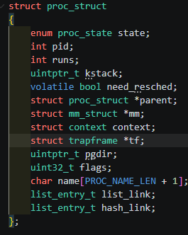

get_pte(),同一个物理页可以映射到多个虚拟地址吗，删除一个会怎么样，ucore用哪些数据结构管理
以及pageinsert和remove
mm_struct,context和trapframe区别，save和restore如何实现开关中断，`get_pte()` 函数中有两段形式类似的代码，结合 `sv32`、`sv39`、`sv48` 的异同，解释这两段代码为什么如此相像，创建第 1 个内核线程initproc过程

讲一下这几个
然后线程的切换
trapfram和context区别
kernel_thread这个函数然后还有整个lab的执行流
还有更新和删除地址映射的两个函数
